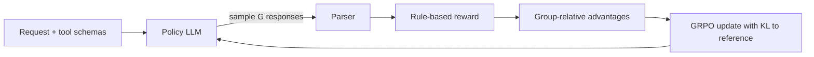

# Idea 1: Reliable Tool Calling with Reinforcement Learning

> Train a small open LLM with GRPO and verifiable, rule-based rewards to make correct tool (function) calls, and test whether it generalizes to tools it never saw during training better than supervised fine-tuning.

**Status:** Proposal
**Course:** MSML635
**Compute:** 1 GPU (24–48 GB) with LoRA

---

## Table of Contents

- [Motivation](#motivation)
- [Problem Formulation](#problem-formulation)
- [Reward Design](#reward-design)
- [Data](#data)
- [Models and Tooling](#models-and-tooling)
- [Experiments](#experiments)
- [Metrics](#metrics)
- [Milestones](#milestones)
- [Risks and Pitfalls](#risks-and-pitfalls)
- [Stretch Goals](#stretch-goals)
- [References](#references)

---

## Motivation

LLM agents depend on tool calling: deciding which API or function to call and with which arguments. In practice, models fail in predictable ways:

| Failure mode | Example |
|---|---|
| Invalid format | Malformed JSON that cannot be parsed |
| Hallucinated tool | Calling `get_weather_forecast` when only `get_weather` exists |
| Wrong arguments | Missing required parameters, wrong types, invented parameter names |
| Over-calling | Calling a tool when the question can be answered directly |
| Under-calling | Answering in text when a tool call was required |

The standard fix is **supervised fine-tuning (SFT)** on example tool calls. SFT teaches the model to imitate one reference answer, which tends to break down on unfamiliar tools or more complex requests. It also penalizes *any* deviation from the reference, even when the deviation is still correct (e.g., a different argument order or an equivalent value).

**Reinforcement learning with verifiable rewards (RLVR)**, the approach behind DeepSeek-R1, offers an alternative: instead of copying a reference, the model is rewarded for *any* call that a checker verifies as correct. Recent work (ToolRL, NeurIPS 2025) found that GRPO with carefully decomposed rewards outperformed both base models and SFT models on tool-use benchmarks.

**Research question:** Does RL with rule-based rewards produce more reliable tool calling than SFT, especially on tools unseen during training?

---

## Problem Formulation

We frame single-turn tool calling as a **contextual bandit**:

| Bandit component | In this project |
|---|---|
| Context $x$ | User request + list of available tool schemas |
| Action $y$ | The model's full response: one or more tool calls, or a plain-text answer |
| Reward $r(x, y)$ | Computed by code that checks the response against the ground-truth call |
| Policy $\pi_\theta(y \mid x)$ | The LLM being trained |

Unlike RLHF (e.g., InstructGPT), there is **no learned reward model**. The reward is rule-based and verifiable, which removes one major source of reward hacking.

We optimize the policy with **GRPO** (Group Relative Policy Optimization). For each prompt, GRPO samples a group of $G$ responses, scores them, and uses each response's reward relative to the group mean as its advantage. This removes the need for PPO's separate value network:

$$\hat{A}_i = \frac{r_i - \text{mean}(r_1, \dots, r_G)}{\text{std}(r_1, \dots, r_G)}$$

---

## Reward Design

Reward design is the core of this project. The proposed reward is:

$$
R(x, y) =
\begin{cases}
0 & \text{if } y \text{ cannot be parsed} \\
R_{\text{format}} + w_1 \cdot F_1(\text{tool names}) + w_2 \cdot F_1(\text{param keys}) + w_3 \cdot \text{ValueMatch} & \text{otherwise}
\end{cases}
$$

### Design decisions

1. **Gate on format.** Unparseable output gets zero reward, so the model learns valid structure first.
2. **Use F1, not recall, for tool names.** Rewarding only "called the right tool" lets the model hack the reward by calling *every* tool. F1 penalizes extra calls.
3. **Include "no tool needed" examples.** Create them by removing the correct tool from the available list; the correct response is then to not call anything. Without these, the model learns to always call something. With too many, it learns to always abstain.
4. **Normalize values before comparing.** Treat equivalent values as matches (`5` vs `5.0`, case and whitespace differences, argument order). This is a key advantage over SFT, which penalizes any deviation from the reference.
5. **Unit-test the reward function** on hand-written correct and incorrect outputs *before* any training run.

### Reward variants to compare

| Variant | Description |
|---|---|
| Binary | 1 if the full call is exactly correct, else 0 |
| Partial | Decomposed reward above, with partial credit |
| Partial + abstention | Partial reward plus explicit credit for correctly not calling a tool |

---

## Data

| Purpose | Source |
|---|---|
| Training | [Salesforce xLAM function-calling 60k](https://huggingface.co/datasets/Salesforce/xlam-function-calling-60k) (from the APIGen pipeline), optionally [Glaive function calling v2](https://huggingface.co/datasets/glaiveai/glaive-function-calling-v2) |
| Evaluation | [Berkeley Function Calling Leaderboard (BFCL)](https://gorilla.cs.berkeley.edu/leaderboard.html) |
| Abstention data | Generated by removing the correct tool from training examples |

### Key split: seen vs. unseen tools

Hold out **entire tools or tool domains** from training. Generalization to unseen tools is the main argument for RL over SFT, so this split determines whether the project's central claim holds.

> ⚠️ Check dataset licenses and verify that no evaluation examples leak into training.

---

## Models and Tooling

| Component | Choice |
|---|---|
| Base model | Small instruct model, 1.5B–3B parameters (e.g., Qwen2.5-Instruct family) |
| Fine-tuning | LoRA |
| RL trainer | [Hugging Face TRL](https://github.com/huggingface/trl) `GRPOTrainer` |
| Fast generation | [vLLM](https://github.com/vllm-project/vllm) for rollouts |
| Constrained decoding baseline | [Outlines](https://github.com/dottxt-ai/outlines) |
| Experiment tracking | Weights & Biases or TensorBoard |

---

## Experiments

### Baselines

1. **Base instruct model**, zero-shot
2. **SFT** on the same training data
3. **Grammar-constrained decoding**, which forces valid JSON. This tests an important distinction: constrained decoding guarantees *valid syntax* but not *correct semantics* (right tool, right arguments). If RL improves on it, the improvement comes from better decisions, not just better formatting.

### Main comparison

| Run | Description |
|---|---|
| GRPO (cold start) | GRPO directly from the instruct model |
| SFT → GRPO | SFT first, then GRPO |

Do not assume SFT-first wins. ToolRL reported that initializing GRPO from an SFT model did not consistently beat starting from the raw instruct model.

### Ablations

- Binary vs. partial rewards
- Proportion of "no tool needed" examples (e.g., 0%, 10%, 25%)
- KL coefficient $\beta$
- Group size $G$

---

## Metrics

| Metric | What it measures |
|---|---|
| BFCL accuracy | Overall tool-calling correctness on a standard benchmark |
| Valid-JSON rate | Format reliability |
| Hallucinated-tool rate | Calls to tools that don't exist |
| Abstention accuracy | Correctly not calling a tool when none fits |
| Seen vs. unseen tool accuracy | Generalization |
| Mean response length | Watch for verbose or degenerate outputs |

---

## Milestones

- [ ] **Setup:** environment, base model inference, BFCL evaluation running
- [ ] **Baselines:** zero-shot, constrained decoding, and SFT results
- [ ] **Reward:** implement and unit-test the reward function
- [ ] **RL:** first GRPO run on a small subset; verify reward increases
- [ ] **Main runs:** cold-start GRPO vs. SFT → GRPO on full data
- [ ] **Ablations:** reward variants, abstention ratio, $\beta$, $G$
- [ ] **Analysis:** seen vs. unseen tools, failure case review
- [ ] **Write-up:** results, plots, and lessons learned

---

## Risks and Pitfalls

| Risk | Mitigation |
|---|---|
| Chat-template mismatch between training and evaluation | Use one shared formatting function everywhere |
| Bugs in the reward parser | Unit-test the reward function before training |
| Reward hacking (e.g., calling all tools, always abstaining) | Use F1 rewards; log and read sample outputs at every checkpoint |
| Evaluation leakage | Hold out entire tools; deduplicate train and eval |
| GPU memory limits | LoRA, smaller model, smaller group size, gradient checkpointing |

---

## Stretch Goals

- **Multi-turn tool use:** the model calls a tool, receives a mocked result, and continues until the task is complete. This turns the contextual bandit into a full MDP with credit assignment across turns.
- **Execution-based rewards:** run calls against mock APIs and compare outputs instead of comparing call syntax.
- **Combine with Idea 2:** use this model as the cheap arm in the bandit router (see [`../README.md`](../README.md)).

---

## References

- Qian et al. (2025). *ToolRL: Reward is All Tool Learning Needs.* NeurIPS 2025. [arXiv:2504.13958](https://arxiv.org/abs/2504.13958) · [Code](https://github.com/qiancheng0/ToolRL)
- Guo et al. (2025). *DeepSeek-R1: Incentivizing Reasoning Capability in LLMs via Reinforcement Learning.* Nature 645. [arXiv:2501.12948](https://arxiv.org/abs/2501.12948)
- Shao et al. (2024). *DeepSeekMath: Pushing the Limits of Mathematical Reasoning in Open Language Models* (introduces GRPO). [arXiv:2402.03300](https://arxiv.org/abs/2402.03300)
- Ouyang et al. (2022). *Training Language Models to Follow Instructions with Human Feedback.* NeurIPS 2022. [arXiv:2203.02155](https://arxiv.org/abs/2203.02155)
- Liu et al. (2024). *APIGen: Automated Pipeline for Generating Verifiable and Diverse Function-Calling Datasets.*
- Berkeley Function Calling Leaderboard (BFCL). [Leaderboard](https://gorilla.cs.berkeley.edu/leaderboard.html)
