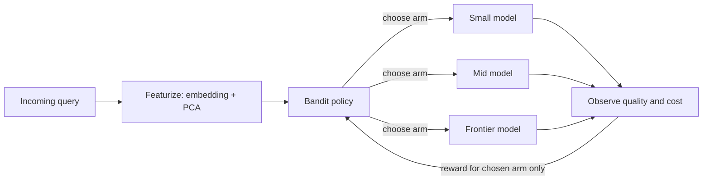

# Idea 2: Cost-Aware LLM Routing with Contextual Bandits

> Build a router that decides, for each query, which LLM to send it to, learning online with contextual bandit algorithms to balance answer quality against inference cost, and adapting when models, prices, or traffic change.

**Status:** Proposal
**Course:** MSML635
**Compute:** CPU only (no LLM training); small one-time cost to collect model responses

---

## Table of Contents

- [Motivation](#motivation)
- [Problem Formulation](#problem-formulation)
- [Why a Bandit and Not a Classifier?](#why-a-bandit-and-not-a-classifier)
- [Data](#data)
- [Methods](#methods)
- [Experiments](#experiments)
- [Off-Policy Evaluation](#off-policy-evaluation)
- [System Demo](#system-demo)
- [Metrics](#metrics)
- [Milestones](#milestones)
- [Risks and Pitfalls](#risks-and-pitfalls)
- [References](#references)

---

## Motivation

LLM APIs charge per token, and frontier models cost far more than small ones. Yet many queries (simple factual questions, easy math, short rewrites) don't need the most expensive model. A **router** sends each query to the cheapest model that is likely to answer it well.

This is a real industry problem. RouteLLM (ICLR 2025), for example, reported routers that cut costs by over 85% on MT Bench, 45% on MMLU, and 35% on GSM8K compared with always using GPT-4, while retaining 95% of GPT-4's performance.

**Research question:** Can a contextual bandit router match a supervised router when full information is available, and outperform it under the conditions found in production: partial feedback and changing environments?

---

## Problem Formulation

| Bandit component | In this project |
|---|---|
| Context $x$ | Query features: sentence embedding (PCA-reduced), length, task type |
| Arms $a \in \mathcal{A}$ | Available models, e.g., small local model, mid-tier API, frontier API |
| Reward $r(x, a)$ | Quality of model $a$'s answer minus a cost penalty |
| Feedback | Only the chosen arm's reward is observed |

The reward trades off quality against cost:

$$r(x, a) = \text{quality}(x, a) - \lambda \cdot \text{cost}(a)$$

where $\text{quality} \in [0, 1]$ (e.g., answer correctness), $\text{cost}$ is normalized token cost, and $\lambda$ sets the trade-off. Sweeping $\lambda$ traces out a cost–quality curve.

---

## Why a Bandit and Not a Classifier?

This is the central design question of the project.

If every model is run on every query offline, we have **full information** (we know how every model would have done), and supervised learning is the right tool. RouteLLM, for instance, trains a supervised routing function from preference data. **We include a supervised classifier as a strong baseline.**

A bandit becomes the right tool under production conditions:

| Condition | Why it matters |
|---|---|
| **Partial feedback** | In production, you only see how the *chosen* model performed. Running every model on every query to get labels defeats the purpose of saving cost. |
| **Non-stationarity** | New models launch, prices change, and user traffic shifts. A static classifier goes stale; a bandit keeps learning. |
| **Exploration** | Learning about a new model requires sending it some traffic. Bandits manage this exploration–exploitation trade-off explicitly. |

The experiments below are designed to **demonstrate** these conditions, not just assume them.

---

## Data

### Collecting responses

Run each candidate model once on a mixed pool of queries with **verifiable answers**, and record correctness and token cost for every (model, query) pair:

| Domain | Example datasets |
|---|---|
| Math | GSM8K |
| Knowledge | MMLU |
| Code | HumanEval, MBPP |

Precomputed multi-model benchmarks such as RouterBench can replace this step and avoid API costs. RouteLLM also released its routing data and code.

### Simulating bandit feedback

Because the offline data has full information, we **simulate** partial feedback: the bandit algorithm only receives the reward of the arm it chose, while the evaluation code still knows the reward of every arm. This allows exact computation of regret against the oracle.

> ⚠️ Prefer verifiable tasks for main results. LLM-as-judge scores are noisy and biased (e.g., toward longer answers). If used for open-ended queries, report this as a limitation.

---

## Methods

### Features

- Sentence embeddings (e.g., a small sentence-transformers model), reduced to 32–128 dimensions with PCA, since linear bandits degrade in very high dimensions
- Optional: query length, detected task type

### Baselines

| Baseline | Description |
|---|---|
| Always-cheap / always-expensive | Lower and upper anchors for cost |
| Random | Uniform over arms |
| Oracle | Best arm per query in hindsight (upper bound on reward) |
| Supervised classifier | Trained with full information |
| Cascade | Try the cheap model first; escalate if confidence is low (FrugalGPT-style) |

### Bandit algorithms

| Algorithm | Exploration strategy |
|---|---|
| $\varepsilon$-greedy | Random arm with probability $\varepsilon$ |
| **LinUCB** | One linear reward model per arm plus an uncertainty bonus |
| **Linear Thompson Sampling** | Samples from a posterior over reward models |
| Neural bandit (optional) | Neural network reward model with exploration |

LinUCB chooses:

$$a_t = \arg\max_{a} \left( \hat{\theta}_a^\top x_t + \alpha \sqrt{x_t^\top A_a^{-1} x_t} \right)$$

where $\hat{\theta}_a$ is arm $a$'s estimated reward model, $A_a$ accumulates the contexts seen for arm $a$, and $\alpha$ controls exploration.

---

## Experiments

1. **Cost–quality Pareto frontier.** Sweep $\lambda$ and plot average quality vs. average cost for every method. This is the headline figure.
2. **Regret curves.** Plot cumulative regret against the oracle over time for each bandit algorithm.
3. **Non-stationarity (key experiment).** Partway through the query stream, introduce a change:
   - add a new model,
   - change a model's price, or
   - shift the query mix toward a different task.

   Measure how quickly each method adapts. The expectation is that the static classifier degrades while the bandits recover.
4. **Cold start.** How many queries does each bandit need before it beats the always-expensive baseline on the reward?

---

## Off-Policy Evaluation

In real systems, new routing policies can't always be tested safely on live traffic. Instead, a new policy's value is estimated from logs collected under the old one.

We will implement **inverse propensity scoring (IPS)**:

$$\hat{V}(\pi) = \frac{1}{n} \sum_{i=1}^{n} \frac{\mathbb{1}[\pi(x_i) = a_i]}{p_i} \, r_i$$

where $a_i$ is the logged action, $p_i$ is the probability with which the logging policy chose it, and $r_i$ is the observed reward. Optionally, we will also implement the **doubly robust** estimator, which reduces variance.

Because the simulator knows the true value of every policy, we can **validate** the IPS estimates against ground truth. This also shows why the logging policy must record its action probabilities (propensities): without them, unbiased off-policy evaluation is not possible.

---

## System Demo

A small serving layer to show the router working end to end:

- **FastAPI service** with an OpenAI-compatible endpoint
- **Logging** of each decision: chosen arm, propensity, cost, and observed outcome
- **Dashboard** showing cumulative cost saved vs. always using the frontier model
- **Router latency** measured and reported (target: a few milliseconds)

---

## Metrics

| Metric | What it measures |
|---|---|
| Average quality | Answer correctness across queries |
| Average cost per query | Inference spend |
| Cost savings at fixed quality | Business impact, e.g., "X% cheaper at Y% quality loss" |
| Cumulative regret | Online learning efficiency |
| Recovery time after a shift | Adaptability |
| IPS estimate error | Reliability of off-policy evaluation |
| Router latency | Production overhead |

---

## Milestones

- [ ] **Data:** collect or download per-model correctness and costs
- [ ] **Simulator:** stream queries with partial feedback; compute oracle and regret
- [ ] **Baselines:** fixed policies, oracle, supervised classifier, cascade
- [ ] **Bandits:** $\varepsilon$-greedy, LinUCB, Thompson sampling
- [ ] **Pareto frontier:** sweep $\lambda$ for all methods
- [ ] **Non-stationarity:** new-model, price-change, and traffic-shift scenarios
- [ ] **Off-policy evaluation:** IPS (and optionally doubly robust), validated against ground truth
- [ ] **Demo:** FastAPI service, logging, and dashboard
- [ ] **Write-up:** results, plots, and lessons learned

---

## Risks and Pitfalls

| Risk | Mitigation |
|---|---|
| Supervised baseline beats the bandit under full information | Expected; the non-stationarity and partial-feedback experiments are where bandits should win |
| High-dimensional embeddings make LinUCB slow or unstable | PCA to 32–128 dimensions; regularization |
| Noisy quality labels | Use verifiable tasks for main results |
| Cost and quality on different scales | Normalize both; report results across a sweep of $\lambda$ |
| Leakage between feature fitting and evaluation | Fit PCA and any classifiers on a separate split |

---

## References

- Ong et al. (2025). *RouteLLM: Learning to Route LLMs with Preference Data.* ICLR 2025. [arXiv:2406.18665](https://arxiv.org/abs/2406.18665) · [Code](https://github.com/lm-sys/RouteLLM)
- Chen et al. (2023). *FrugalGPT: How to Use Large Language Models While Reducing Cost and Improving Performance.* [arXiv:2305.05176](https://arxiv.org/abs/2305.05176)
- Hu et al. (2024). *RouterBench: A Benchmark for Multi-LLM Routing System.*
- Li et al. (2010). *A Contextual-Bandit Approach to Personalized News Article Recommendation* (LinUCB). [arXiv:1003.0146](https://arxiv.org/abs/1003.0146)
- Agrawal & Goyal (2013). *Thompson Sampling for Contextual Bandits with Linear Payoffs.* [arXiv:1209.3352](https://arxiv.org/abs/1209.3352)
- Dudík, Langford & Li (2011). *Doubly Robust Policy Evaluation and Learning.* [arXiv:1103.4601](https://arxiv.org/abs/1103.4601)
