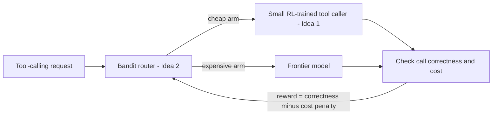

# Project Ideas

Candidate project ideas for **MSML635**, both applying reinforcement learning to large language models.

| # | Idea | RL setting | Compute |
|---|---|---|---|
| 1 | [Reliable Tool Calling with RL](01-rl-tool-calling/README.md) | GRPO with verifiable, rule-based rewards | 1 GPU (24–48 GB) |
| 2 | [Cost-Aware LLM Routing with Contextual Bandits](02-bandit-llm-router/README.md) | Contextual bandits (LinUCB, Thompson sampling) | CPU only |

## How the two ideas connect

Both ideas are framed as **contextual bandits**, but they use RL differently:

- **Idea 1** uses RL to *train a model*: the policy is an LLM, and the reward checks whether its tool calls are correct.
- **Idea 2** uses RL to *choose a model*: the policy is a lightweight router, and the reward balances answer quality against cost.

## Combined version

The ideas fit together into one end-to-end system:

1. Train a small model with GRPO to make reliable tool calls (Idea 1).
2. Use it as the cheap arm in the bandit router, with a frontier model as the expensive arm (Idea 2).
3. The router learns which requests the small model can handle and when to escalate, and we measure the resulting cost savings.

## Suggested order

- **Limited time or GPU access:** start with Idea 2. It needs no LLM training and produces complete results quickly.
- **Focus on LLM post-training:** start with Idea 1.
- **Both:** do Idea 1 first, since the combined version uses its trained model.
